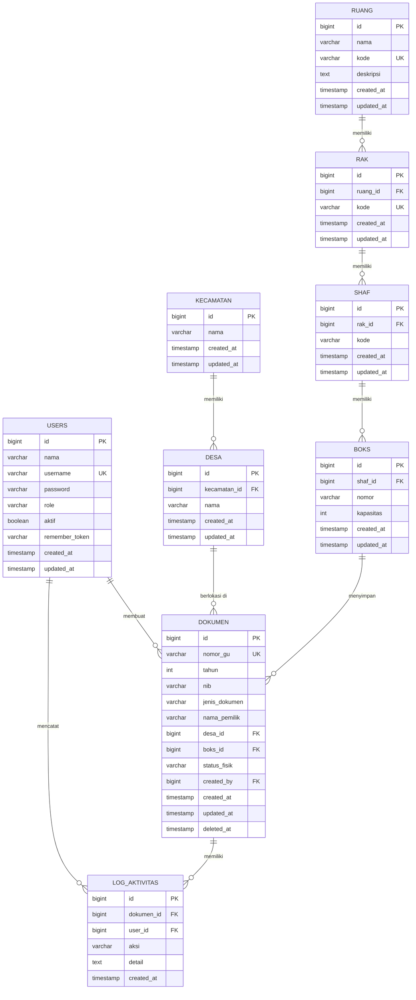

# Entity Relationship Diagram (ERD) — SIPLOK
## Pemodelan Basis Data Relasional Dokumen Fisik Pertanahan (PostgreSQL 16)
**Instansi:** Kantor Pertanahan Kabupaten Banyumas, ATR/BPN  
**Target Basis Data:** PostgreSQL 16 LTS  

---

## 1. Deskripsi Entitas Basis Data

Sistem Informasi Pelacakan Lokasi Dokumen Fisik Pertanahan (SIPLOK) dibangun di atas 9 entitas tabel relasional yang saling terhubung secara terstruktur:

| No | Nama Tabel | Deskripsi & Peran Fungsional |
| :---: | :--- | :--- |
| 1 | **`users`** | Menyimpan akun pengguna, kredensial hash password, pembagian peran (*role* `ADMIN` atau `USER`), serta status aktif akun. |
| 2 | **`kecamatan`** | Master data wilayah administratif kecamatan di lingkungan yurisdiksi Kabupaten Banyumas. |
| 3 | **`desa`** | Master data wilayah desa/kelurahan yang berada di bawah naungan kecamatan terkait. |
| 4 | **`ruang`** | Master data ruang fisik tempat penyimpanan arsip warkah dan dokumen pertanahan (contoh: Ruang Arsip A). |
| 5 | **`rak`** | Lemari atau rak besi penyimpanan fisik di dalam ruangan tertentu dengan kode unik (contoh: RA-A-01). |
| 6 | **`shaf`** | Baris atau ambalan horizontal di dalam rak tertentu tempat meletakkan boks (contoh: SH-01). |
| 7 | **`boks`** | Boks karton arsip bertutup tempat dokumen fisik dikelompokkan dengan nomor dan kapasitas tertentu (default 50 dokumen). |
| 8 | **`dokumen`** | Entitas data operasional utama yang merekam nomor Gambar Ukur (GU), NIB, pemilik hak, serta relasi lokasi penyimpanannya. Mendukung *Soft Deletes*. |
| 9 | **`log_aktivitas`** | Jejak audit (*immutable audit trail*) yang merekam mutasi pemindahan rak, penambahan dokumen, dan pembaruan status fisik beserta identitas petugas. |

---

## 2. Diagram ERD (Mermaid erDiagram)

---

## 3. Catatan Kardinalitas & Integritas Relasional

### 3.1 Relasi Wilayah Administratif
* **`kecamatan` ke `desa` (One-to-Many / 1:N):**
  * Satu kecamatan membawahi banyak desa/kelurahan di Kabupaten Banyumas.
  * *Constraint:* `ON DELETE CASCADE`. Jika data kecamatan dihapus, seluruh desa yang berada di bawahnya ikut terhapus demi menjaga konsistensi.

### 3.2 Relasi Hierarki Sarana Fisik Arsip
* **`ruang` $\rightarrow$ `rak` $\rightarrow$ `shaf` $\rightarrow$ `boks` (Hierarchical 1:N):**
  * **Ruang ke Rak (1:N):** Satu ruang arsip menampung beberapa deretan lemari rak. Kode rak bersifat unik di seluruh kantor (`UNIQUE(kode)`).
  * **Rak ke Shaf (1:N):** Setiap rak memiliki 3 tingkatan ambalan shaf (`SH-01`, `SH-02`, `SH-03`). Untuk mencegah bentrokan nama antar lemari, shaf dikunci dengan batasan komposit: `CONSTRAINT uq_shaf_rak_kode UNIQUE (rak_id, kode)`.
  * **Shaf ke Boks (1:N):** Setiap shaf memuat sejumlah boks karton (rata-rata 5 boks). Penomoran boks dikunci secara komposit: `CONSTRAINT uq_boks_shaf_nomor UNIQUE (shaf_id, nomor)`.
  * *Constraint:* Seluruh relasi sarana fisik menerapkan `ON DELETE CASCADE` dari ruang hingga boks.

### 3.3 Relasi Dokumen Pertanahan
* **`boks` ke `dokumen` (One-to-Many / 1:N):**
  * Satu boks dapat menyimpan hingga 50 dokumen fisik pertanahan. Dokumen merujuk ke satu `boks_id`.
  * *Constraint:* `RESTRICT` (default) untuk mencegah penghapusan boks yang masih terisi dokumen aktif.
* **`desa` ke `dokumen` (One-to-Many / 1:N):**
  * Objek bidang tanah pada dokumen fisik terkait secara yuridis pada desa tertentu.
* **`users` ke `dokumen` (One-to-Many / 1:N):**
  * Melacak petugas yang pertama kali menginput data dokumen (`created_by`).
* **Integritas Nilai Kolom (*Check Constraints* PostgreSQL):**
  * `CHECK (role IN ('ADMIN', 'USER'))` pada tabel `users`.
  * `CHECK (status_fisik IN ('TERSEDIA', 'DIPINJAM', 'RUSAK', 'HILANG'))` pada tabel `dokumen`.

### 3.4 Relasi Jejak Audit (*Audit Trail*)
* **`dokumen` ke `log_aktivitas` (1:N) & `users` ke `log_aktivitas` (1:N):**
  * Setiap mutasi pemindahan rak, penambahan, maupun perubahan status dicatat secara detail beserta waktu timestamp kejadiannya.
  * Dihubungkan dengan `ON DELETE CASCADE` terhadap dokumen induknya.

---

## 4. Rekomendasi Indeks Performa Basis Data

Untuk menjamin kueri pencarian instan ($\le 2$ detik) pada volume puluhan ribu bidang tanah, indeks B-Tree wajib dipasang pada kolom-kolom berikut:

| Nama Indeks | Nama Tabel | Kolom Sasaran | Alasan & Manfaat Performa |
| :--- | :--- | :--- | :--- |
| `idx_dokumen_nomor_gu` | `dokumen` | `nomor_gu` (Unique) | Mempercepat pencarian kunci utama berkas Gambar Ukur dan pengecekan duplikasi real-time. |
| `idx_dokumen_nib` | `dokumen` | `nib` | Mempercepat pencarian kadastral berbasis Nomor Induk Bidang 11 digit. |
| `idx_dokumen_nama_pemilik` | `dokumen` | `nama_pemilik` | Mempercepat pencarian nama pemegang hak atas tanah (`ILIKE %search%`). |
| `idx_dokumen_boks_id` | `dokumen` | `boks_id` | Mengoptimalkan penghitungan sisa kapasitas boks (*count query*) pada dropdown lokasi. |
| `idx_dokumen_status_fisik` | `dokumen` | `status_fisik` | Mempercepat filter dokumen yang sedang dipinjam atau dalam kondisi rusak. |
| `idx_log_dokumen_id` | `log_aktivitas` | `dokumen_id` | Mempercepat pengambilan 20 jejak audit riwayat mutasi pada drawer detail. |
| `idx_log_created_at` | `log_aktivitas` | `created_at DESC` | Mempercepat sorting log aktivitas kronologis terbaru di panel administrator. |
