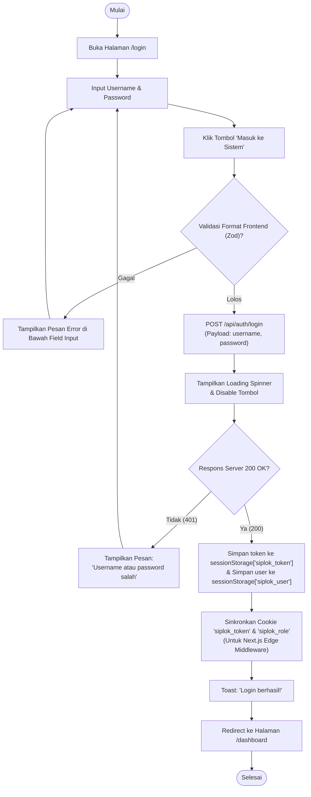
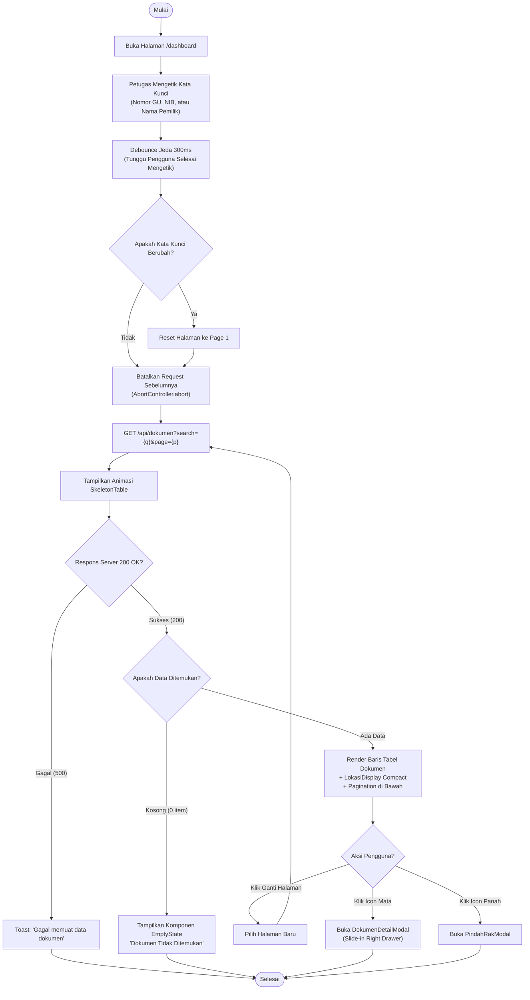
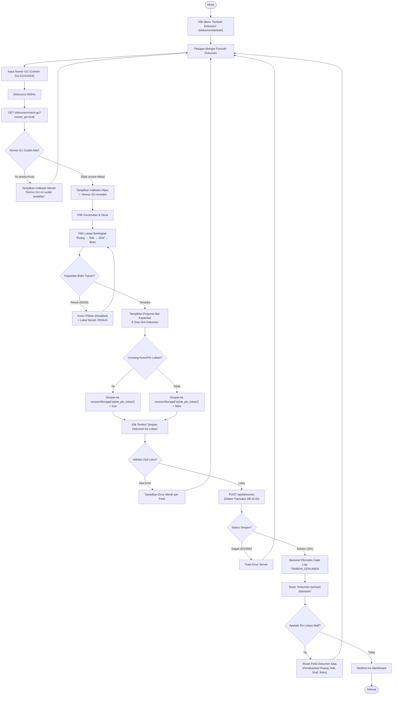
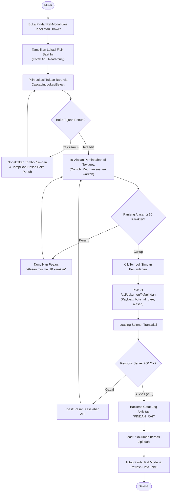
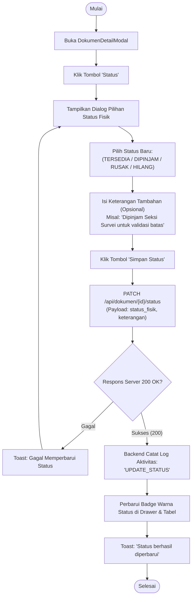
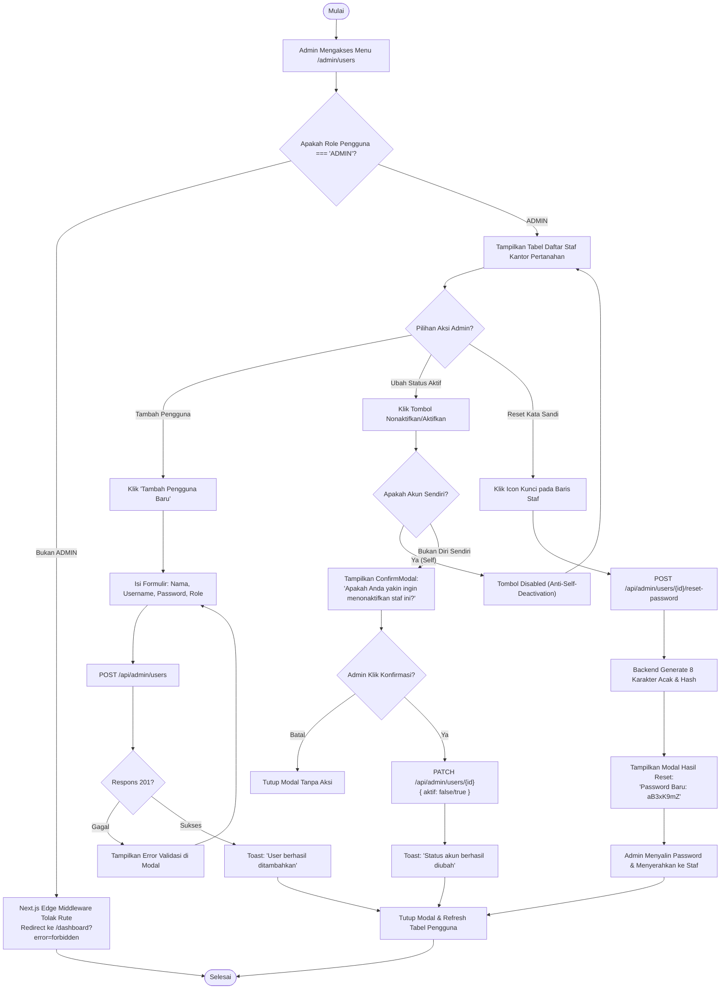

# Alur Logika Sistem (Flowchart) — SIPLOK
## Kantor Pertanahan Kabupaten Banyumas, ATR/BPN
Dokumen ini memetakan 6 diagram alur kerja utama aplikasi SIPLOK menggunakan standar notasi Mermaid (*flowchart*).

---

## 1. Alur Login & Autentikasi Pengguna

Diagram ini menjelaskan alur otentikasi petugas ke dalam sistem menggunakan enkripsi JWT, validasi form Zod, dan penyimpanan sesi ganda (*sessionStorage* + *cookie*).

---

## 2. Alur Pencarian Dokumen Real-Time

Diagram ini menjelaskan alur pencarian berkas pertanahan dengan proteksi *debounce*, pembatalan request lama via *AbortController*, dan penanganan data kosong.

---

## 3. Alur Tambah Dokumen Baru & Pin Lokasi

Diagram ini menjelaskan proses penambahan berkas baru, verifikasi keunikan nomor GU secara real-time, seleksi lokasi bertingkat, dan fungsi *Pin Lokasi*.

---

## 4. Alur Pindah Rak Dokumen

Diagram ini menggambarkan mutasi pemindahan dokumen ke boks baru yang disertai validasi kapasitas dan pencatatan alasan pemindahan.

---

## 5. Alur Update Status Fisik Dokumen

Diagram ini menjelaskan alur pengubahan status fisik warkah (*TERSEDIA*, *DIPINJAM*, *RUSAK*, *HILANG*) saat dokumen dipinjam antar seksi dinas.

---

## 6. Alur Administrator Kelola Pengguna

Diagram ini menjelaskan tata cara Administrator dalam menambah petugas baru, menonaktifkan akun staf dengan konfirmasi modal, dan mereset kata sandi acak.

