# Spesifikasi Kebutuhan Perangkat Lunak (SRS)
## SIPLOK — Sistem Informasi Pelacakan Lokasi Dokumen Fisik Pertanahan
**Versi:** 1.0.0 | **Tanggal:** Desember 2024  
**Instansi:** Kantor Pertanahan Kabupaten Banyumas, Kementerian Agraria dan Tata Ruang / Badan Pertanahan Nasional (ATR/BPN)

---

## 1. Pendahuluan

### 1.1 Tujuan Dokumen
Dokumen *Software Requirements Specification* (SRS) ini bertujuan untuk mendefinisikan seluruh kebutuhan fungsional dan non-fungsional dari **SIPLOK (Sistem Informasi Pelacakan Lokasi Dokumen Fisik Pertanahan)**. Dokumen ini menjadi acuan tunggal bagi tim pengembang perangkat lunak, analis sistem, administrator infrastruktur IT, serta pemangku kepentingan (*stakeholders*) di lingkungan Kantor Pertanahan Kabupaten Banyumas dalam memahami ruang lingkup, arsitektur, dan perilaku sistem secara menyeluruh.

### 1.2 Ruang Lingkup Sistem
SIPLOK adalah perangkat lunak internal berbasis web (*intranet web application*) yang dirancang khusus untuk memecahkan kendala pengelolaan dokumen fisik pertanahan (Gambar Ukur, Surat Ukur, Buku Tanah/Sertipikat, Warkah, dan Formulir Pengakuan Hak).

Ruang lingkup sistem meliputi:
1. **Pencatatan Koordinat Lokasi Fisik:** Memetakan posisi fisik dokumen ke dalam hierarki penyimpanan bertingkat: Ruang Arsip $\rightarrow$ Lemari Rak $\rightarrow$ Shaf/Ambalan $\rightarrow$ Nomor Boks Arsip.
2. **Pelacakan & Pencarian Real-Time:** Memberikan kemampuan pencarian instan berdasarkan Nomor GU, NIB (Nomor Induk Bidang), dan Nama Pemilik Hak Atas Tanah dengan jeda pencarian (*debounce*) guna mencegah beban berlebih pada basis data.
3. **Pencatatan Mutasi & Peminjaman Fisik:** Merekam setiap pemindahan dokumen antar rak/boks dan pembaruan status fisik dokumen (*TERSEDIA*, *DIPINJAM*, *RUSAK*, *HILANG*) secara akuntabel.
4. **Audit Trail Otomatis:** Mencatat riwayat log aktivitas yang tidak dapat diubah (*immutable audit trail*) atas seluruh aksi penambahan, pemindahan, dan pembaruan dokumen.

*Batasan Lingkup:* Sistem ini **bukan** merupakan sistem layanan publik eksternal, tidak menyediakan fitur unggah berkas pindaian (*digital document scanning/uploading*), dan berdiri sendiri (*standalone*) tanpa koneksi langsung ke server KKP Pusat pada fase pertama ini.

### 1.3 Definisi, Akronim, dan Singkatan

| Istilah / Akronim | Definisi / Penjelasan dalam Konteks Sistem |
| :--- | :--- |
| **ATR/BPN** | Kementerian Agraria dan Tata Ruang / Badan Pertanahan Nasional Republik Indonesia. |
| **Kantah** | Kantor Pertanahan tingkat Kabupaten/Kota (dalam hal ini Kantah Kab. Banyumas). |
| **GU** | **Gambar Ukur**, dokumen otentik yang memuat data hasil pengukuran bidang tanah di lapangan yang dibuat oleh petugas ukur/kadastral. Format penomoran: `GU-XXXX/YYYY`. |
| **NIB** | **Nomor Induk Bidang**, tanda pengenal unik bidang tanah sepanjang 11 digit angka standar kadastral nasional (dimulai dengan kode wilayah 3302 untuk Banyumas). |
| **Warkah** | Kumpulan dokumen bukti yuridis dan fisik yang menjadi dasar penerbitan sertipikat hak atas tanah. |
| **SU** | **Surat Ukur**, kutipan peta pendaftaran tanah yang memuat batas, luas, dan letak bidang tanah. |
| **Sertipikat** | Surat tanda bukti hak atas tanah, hak pengelolaan, hak tanggungan, atau tanah wakaf. |
| **Ruang** | Unit fisik ruangan khusus tempat penyimpanan berkas arsip (contoh: Ruang Arsip A). |
| **Rak** | Lemari atau rak besi tempat menempatkan shaf-shaf arsip pertanahan (contoh: RA-A-01). |
| **Shaf** | Baris atau ambalan horizontal di dalam suatu rak lemari (contoh: SH-01). |
| **Boks** | Kotak/boks karton arsip standar arsip nasional berkapasitas rata-rata 50 berkas fisik (contoh: Boks 001). |
| **JWT** | *JSON Web Token*, standar terbuka (RFC 7519) untuk transmisi data keamanan terotentikasi. |
| **API** | *Application Programming Interface*, antarmuka komunikasi terstandar antar-layanan. |
| **CRUD** | *Create, Read, Update, Delete*, empat operasi dasar manipulasi basis data. |
| **SPA** | *Single Page Application*, aplikasi web dinamis yang merender antarmuka tanpa memuat ulang seluruh halaman. |
| **ORM** | *Object-Relational Mapping* (Eloquent di Laravel). |
| **PK / FK** | *Primary Key* (Kunci Utama) / *Foreign Key* (Kunci Tamu Relasional). |
| **CORS** | *Cross-Origin Resource Sharing*, mekanisme keamanan browser untuk membatasi akses lintas domain. |
| **XSS** | *Cross-Site Scripting*, celah keamanan injeksi skrip klien berbahaya. |
| **CSRF** | *Cross-Site Request Forgery*, serangan manipulasi permintaan atas nama pengguna terotentikasi. |

### 1.4 Referensi
1. Peraturan Menteri ATR/Kepala BPN Nomor 1 Tahun 2021 tentang Dokumen Elektronik.
2. Peraturan Menteri Negara Agraria/Kepala BPN Nomor 3 Tahun 1997 tentang Ketentuan Pelaksanaan PP Nomor 24 Tahun 1997 tentang Pendaftaran Tanah.
3. Standar Operasional Prosedur (SOP) Pengelolaan Arsip Fisik Warkah Kantor Pertanahan Kabupaten Banyumas.
4. Dokumentasi Resmi Laravel 11/13 Framework (`laravel.com/docs`).
5. Dokumentasi Resmi Next.js 16 App Router (`nextjs.org/docs`).

### 1.5 Gambaran Umum Dokumen
Dokumen ini disusun menjadi beberapa bab:
* **Bab 1:** Pendahuluan, ruang lingkup, definisi istilah, dan referensi dasar.
* **Bab 2:** Deskripsi umum produk, perspektif, fungsi utama, karakteristik pengguna, dan asumsi ketergantungan.
* **Bab 3:** Kebutuhan fungsional terinci (FR-01 hingga FR-16).
* **Bab 4:** Kebutuhan non-fungsional (performa, keamanan, keandalan, usabilitas, portabilitas).
* **Bab 5:** Batasan-batasan implementasi sistem.
* **Bab 6:** Pemodelan Use Case Diagram berbasis diagram visual Mermaid.

---

## 2. Deskripsi Umum

### 2.1 Perspektif Produk
Sebelum adanya SIPLOK, pencarian warkah dan gambar ukur di Kantor Pertanahan Kabupaten Banyumas mengandalkan buku register manual serta ingatan juru arsip. Ketika volume berkas tanah melonjak hingga puluhan ribu bidang, proses pencarian fisik dokumen memerlukan waktu antara 30 menit hingga beberapa hari, terutama saat dokumen sedang dipinjam oleh Seksi Survei atau Seksi Penetapan Hak.

SIPLOK hadir sebagai sistem informasi tersentralisasi yang memetakan posisi fisik dokumen ke dalam koordinat boks dan rak secara presisi. Sistem ini beroperasi secara *standalone* di jaringan intranet lokal (*Local Area Network*) Kantor Pertanahan Kabupaten Banyumas menggunakan arsitektur kontainer Docker.

### 2.2 Fungsi Produk
1. **Autentikasi & Otorisasi Pengguna:** Pengamanan sesi berbasis JWT dengan pemisahan peran *ADMIN* dan *USER*.
2. **Pencarian Real-Time:** Menemukan lokasi dokumen dalam waktu kurang dari 2 detik menggunakan filter Nomor GU, NIB, atau Nama Pemilik.
3. **Perekaman Lokasi Fisik:** Penempatan dokumen baru ke boks tertentu dengan validasi kapasitas (maksimal 50 dokumen/boks).
4. **Fitur Kunci Lokasi (Pin Lokasi):** Mempertahankan pilihan boks untuk proses input warkah massal dalam satu ambalan/boks.
5. **Manajemen Mutasi Arsip:** Pencatatan perpindahan dokumen antar boks disertai alasan pemindahan dan pembaruan status fisik (*TERSEDIA*, *DIPINJAM*, *RUSAK*, *HILANG*).
6. **Audit Trail & Jejak Aktivitas:** Perekaman otomatis setiap manipulasi data dokumen ke dalam log aktivitas yang dapat ditinjau oleh Administrator.
7. **Pencetakan Kartu Kendali:** Menghasilkan kartu kendali fisik berformat standar ATR/BPN untuk ditempelkan pada fisik boks atau map warkah.

### 2.3 Karakteristik Pengguna

| Peran (Role) | Perkiraan Jumlah | Tanggung Jawab & Hak Akses | Tingkat Keahlian IT | Contoh Jabatan Riil |
| :--- | :---: | :--- | :--- | :--- |
| **ADMIN** | 1 – 2 Orang | Hak akses penuh: Manajemen akun petugas (tambah, nonaktifkan, reset password), peninjauan log audit aktivitas sistem, dan pengelolaan master tata letak ruang/rak arsip. | Menengah (Menguasai manajemen browser dan dasar operasional sistem IT dinas). | Kepala Subbagian Tata Usaha / Petugas IT Komputer Kantah Banyumas. |
| **USER** | 3 – 10 Orang | Hak akses operasional: Pencarian dokumen, pendaftaran dokumen baru, pemindahan boks/rak, pembaruan status peminjaman berkas, serta pencetakan label fisik. | Dasar (Mampu mengoperasikan peramban web dan aplikasi perkantoran standar). | Petugas Arsip Warkah, Staf Seksi Survei dan Pemetaan, Staf Seksi Pendaftaran Hak. |

### 2.4 Asumsi dan Ketergantungan
1. **Ketersediaan Jaringan Intranet:** Server SIPLOK dapat diakses oleh komputer petugas melalui jaringan LAN Kantor Pertanahan Kabupaten Banyumas.
2. **Peramban Web Klien:** Pengguna menggunakan peramban modern (Google Chrome versi 110+, Mozilla Firefox 110+, atau Microsoft Edge).
3. **Integritas Berkas Fisik:** Petugas melakukan verifikasi fisik dokumen (keabsahan lembar warkah/GU) sebelum menginput data ke dalam SIPLOK.
4. **Kemandirian Jaringan:** Setelah image Docker selesai di-build, sistem dapat beroperasi 100% secara offline tanpa memerlukan koneksi internet publik.

---

## 3. Kebutuhan Fungsional

### FR-01: Login dengan Username dan Password
* **Deskripsi:** Pengguna masuk ke dalam sistem menggunakan kredensial akun terdaftar.
* **Input:** `username` (string), `password` (string).
* **Proses:** Sistem memvalidasi kelengkapan format via Zod, memverifikasi kecocokan hash password bcrypt di basis data, memastikan akun berstatus `aktif = true`, serta menerbitkan token JWT dengan masa berlaku 480 menit (8 jam). Token disimpan di `sessionStorage` klien dan disinkronkan ke cookie `siplok_token`.
* **Output:** Token otentikasi JWT, data profil pengguna, dan pengalihan ke dashboard.
* **Prioritas:** Tinggi
* **Role:** Semua Pengguna

### FR-02: Logout dari Sistem
* **Deskripsi:** Pengguna mengakhiri sesi aktif secara aman.
* **Input:** Permintaan logout dengan Bearer JWT token.
* **Proses:** Sistem mencabut (*invalidate/blacklist*) token JWT pada backend, menghapus kunci `siplok_token` dan `siplok_user` dari `sessionStorage`, serta menghapus cookie sesi di peramban.
* **Output:** Pengalihan kembali ke halaman `/login`.
* **Prioritas:** Tinggi
* **Role:** Semua Pengguna

### FR-03: Proteksi Rute Berdasarkan Role
* **Deskripsi:** Membatasi akses antarmuka halaman berdasarkan status login dan peran pengguna.
* **Input:** Jalur URL permintaan halaman (*route path*).
* **Proses:** Next.js Edge Middleware memeriksa keberadaan token dan role pada cookie. Halaman `/admin/*` hanya dapat dibuka oleh role `ADMIN`. Akses role `USER` ke rute admin otomatis dialihkan ke `/dashboard?error=forbidden`.
* **Output:** Akses diberikan atau dialihkan sesuai izin.
* **Prioritas:** Tinggi
* **Role:** Sistem (Otomatis)

### FR-04: Pencarian Dokumen Real-time dengan Debounce
* **Deskripsi:** Menemukan arsip dokumen pertanahan secara cepat saat petugas mengetik kata kunci.
* **Input:** Kata kunci pencarian (string Nomor GU, NIB, atau Nama Pemilik), parameter halaman (`page`), dan limit (`per_page`).
* **Proses:** Frontend menerapkan jeda debouncing 300ms via `useDebounce`. Jika parameter berubah, request lama dibatalkan (*aborted*) via `AbortController`. Backend menjalankan kueri `ILIKE` PostgreSQL dengan eager loading relasi lokasi.
* **Output:** Daftar dokumen terpaginasi beserta string `lokasi_lengkap` dan badge status.
* **Prioritas:** Tinggi
* **Role:** Semua Pengguna

### FR-05: Melihat Detail Dokumen Lengkap
* **Deskripsi:** Menampilkan informasi komprehensif dokumen tanah dalam drawer samping.
* **Input:** Dokumen ID (bigint).
* **Proses:** Mengambil data relasional lengkap: data objek tanah (NIB, GU, Desa, Kecamatan), visualisasi lokasi fisik (`LokasiDisplay` full), progress bar kapasitas boks, serta 20 riwayat aktivitas mutasi terakhir.
* **Output:** Modal drawer slide-in dari sisi kanan layar.
* **Prioritas:** Tinggi
* **Role:** Semua Pengguna

### FR-06: Tambah Dokumen Baru dengan Validasi
* **Deskripsi:** Mendaftarkan arsip warkah/dokumen fisik baru ke dalam sistem dan boks penyimpanan.
* **Input:** `nomor_gu`, `tahun`, `nib`, `jenis_dokumen`, `nama_pemilik`, `desa_id`, `boks_id`.
* **Proses:** Validasi format via FormRequest Laravel & Zod. Backend menjalankan `DB::transaction()` untuk menyimpan dokumen, mencatat log aktivitas `TAMBAH_DOKUMEN`, serta memvalidasi keunikan Nomor GU.
* **Output:** Dokumen tersimpan dan notifikasi sukses.
* **Prioritas:** Tinggi
* **Role:** Semua Pengguna

### FR-07: Validasi Real-time Nomor GU Unik
* **Deskripsi:** Memeriksa ketersediaan nomor GU sebelum formulir disubmit guna menghindari duplikasi.
* **Input:** Query string `nomor_gu` pada input form.
* **Proses:** Frontend mengirim GET `/dokumen/check-gu` dengan jeda debounce 500ms. Backend mengembalikan status Boolean `exists`.
* **Output:** Pesan visual real-time (hijau jika tersedia, merah jika sudah terdaftar).
* **Prioritas:** Sedang
* **Role:** Semua Pengguna

### FR-08: Cascading Dropdown Lokasi Fisik
* **Deskripsi:** Pemilihan lokasi bertingkat secara berurutan agar penempatan fisik konsisten.
* **Input:** Pilihan Ruang $\rightarrow$ Pilihan Rak $\rightarrow$ Pilihan Shaf $\rightarrow$ Pilihan Boks.
* **Proses:** Pemilihan level induk secara reaktif memicu pengambilan data anak dan mereset pilihan di level bawahnya. Dropdown boks menampilkan sisa kapasitas serta menonaktifkan boks yang telah penuh (kapasitas $\ge$ 50).
* **Output:** Opsi dropdown yang selalu valid dan sinkron.
* **Prioritas:** Tinggi
* **Role:** Semua Pengguna

### FR-09: Fitur Kunci/Pin Lokasi untuk Input Massal
* **Deskripsi:** Mempertahankan koordinat boks yang sama setelah dokumen disimpan.
* **Input:** Status toggle Pin Lokasi (Boolean).
* **Proses:** Menyimpan koordinat lokasi terakhir ke dalam `sessionStorage['siplok_pin_lokasi']`. Saat form disimpan, field dokumen direset namun field lokasi dipertahankan.
* **Output:** Efisiensi input berkas beruntun dalam satu boks yang sama.
* **Prioritas:** Sedang
* **Role:** Semua Pengguna

### FR-10: Pindah Lokasi Dokumen antar Rak
* **Deskripsi:** Memindahkan dokumen dari boks lama ke boks baru disertai jejak alasan.
* **Input:** `boks_id_baru` (bigint), `alasan` (string minimal 10 karakter).
* **Proses:** Dalam transaksi basis data ACID, sistem mencatat lokasi awal, memperbarui relasi `boks_id`, dan menyisipkan entri log aktivitas `PINDAH_RAK` yang memuat keterangan pemindahan.
* **Output:** Lokasi terbarui dan log audit tersimpan.
* **Prioritas:** Tinggi
* **Role:** Semua Pengguna

### FR-11: Update Status Fisik Dokumen
* **Deskripsi:** Memperbarui kondisi fisik dokumen (Tersedia, Dipinjam, Rusak, Hilang).
* **Input:** `status_fisik` (enum), `keterangan` (string opsional).
* **Proses:** Memperbarui nilai status fisik pada tabel dokumen dan membuat catatan log aktivitas `UPDATE_STATUS` yang mencantumkan nama seksi peminjam atau rincian kerusakan berkas.
* **Output:** Badge status terbarui dan riwayat log tercatat.
* **Prioritas:** Tinggi
* **Role:** Semua Pengguna

### FR-12: Cetak Label Lokasi Dokumen
* **Deskripsi:** Menghasilkan kartu label kendali fisik untuk ditempelkan pada fisik boks atau warkah.
* **Input:** Perintah cetak pada dokumen terpilih.
* **Proses:** Mengompilasi template cetak `@media print` yang memuat kop resmi Kantah Banyumas, koordinat lokasi berhuruf besar (Ruang, Rak, Shaf, Boks), barcode/QR placeholder, dan waktu pencetakan.
* **Output:** Tampilan dialog cetak peramban (*print dialog*).
* **Prioritas:** Sedang
* **Role:** Semua Pengguna

### FR-13: Kelola Akun Pengguna (ADMIN)
* **Deskripsi:** Administrator dapat menambah staf baru dan mengelola status keaktifan akun.
* **Input:** `nama`, `username`, `password`, `role` (ADMIN/USER), `aktif` (boolean).
* **Proses:** Backend memvalidasi keunikan username, mengenkripsi password dengan Hash bcrypt, dan mencegah tindakan nonaktif diri sendiri (*anti-self-deactivation*).
* **Output:** Akun pengguna tersimpan atau terbarui.
* **Prioritas:** Sedang
* **Role:** ADMIN

### FR-14: Reset Password Pengguna (ADMIN)
* **Deskripsi:** Mereset kata sandi petugas yang lupa password tanpa melihat kata sandi lama.
* **Input:** ID Pengguna target.
* **Proses:** Sistem menghasilkan string kata sandi acak baru sepanjang 8 karakter alfanumerik, menyimpannya dalam bentuk hash, dan menampilkan teks plaintext sekali saja pada modal konfirmasi administrator.
* **Output:** Kata sandi acak baru yang siap diserahkan kepada petugas.
* **Prioritas:** Sedang
* **Role:** ADMIN

### FR-15: Lihat Log Aktivitas Sistem (ADMIN)
* **Deskripsi:** Memantau seluruh jejak audit manipulasi data di lingkungan kantor pertanahan.
* **Input:** Kata kunci pencarian, filter kategori aksi (`TAMBAH`, `PINDAH`, `STATUS`), halaman.
* **Proses:** Mengambil data tabel `log_aktivitas` secara terpaginasi (diurutkan dari yang paling baru) lengkap dengan nama petugas pelaksana dan nomor GU terkait.
* **Output:** Tabel log audit komprehensif dengan fitur ekspansi rincian.
* **Prioritas:** Sedang
* **Role:** ADMIN

### FR-16: Manajemen Master Lokasi/Ruang (ADMIN)
* **Deskripsi:** Meninjau dan mengonfigurasi struktur fisik ruang arsip, lemari rak, shaf ambalan, dan nomor boks.
* **Input:** Navigasi tab lokasi (Ruang, Rak, Shaf, Boks).
* **Proses:** Menyajikan katalog lokasi fisik dan kapasitas keterisian boks.
* **Output:** Tabel inventarisasi sarana prasarana ruang arsip.
* **Prioritas:** Rendah
* **Role:** ADMIN

---

## 4. Kebutuhan Non-Fungsional

### NF-01: Performa (Performance)
1. Waktu respons kueri pencarian dokumen wajib $\le 2$ detik pada beban data hingga 50.000 entri dokumen.
2. Waktu render halaman antarmuka web wajib $\le 3$ detik pada koneksi LAN kantor.
3. Arsitektur backend mampu melayani minimal 20 permintaan konkuren secara simultan tanpa penurunan performa yang signifikan.

### NF-02: Keamanan (Security)
1. Autentikasi berbasis stateless JWT dengan algoritma HS256 dan masa kedaluwarsa ketat 8 jam kerja (480 menit).
2. Seluruh kata sandi pengguna wajib dienkripsi menggunakan fungsi hash adaptif *bcrypt* dengan faktor biaya (*cost factor*) minimal 12.
3. Pencegahan kerentanan web standar:
   * Proteksi SQL Injection melalui PDO Prepared Statements bawaan Eloquent ORM.
   * Proteksi Cross-Site Scripting (XSS) melalui sanitasi input Zod dan HTML entity encoding bawaan React.
   * Token disimpan dalam `sessionStorage` (terisolasi per-tab) dan cookie beratribut `SameSite=Strict`.

### NF-03: Ketersediaan (Availability)
1. Tingkat ketersediaan sistem (*uptime*) ditargetkan minimal 99% selama jam operasional pelayanan dinas Kantor Pertanahan (Senin s.d. Jumat pukul 07.00 – 17.00 WIB).
2. Penampungan basis data PostgreSQL berjalan dalam kontainer terisolasi dengan persistent volume yang tidak terhapus saat kontainer di-restart.

### NF-04: Usabilitas (Usability)
1. Antarmuka dirancang mengikuti tata warna resmi Kementerian ATR/BPN sehingga mudah dikenali oleh seluruh staf tanpa memerlukan pelatihan operasional lebih dari 30 menit.
2. Seluruh pesan kesalahan, label panduan, dan konfirmasi dialog disajikan dalam Bahasa Indonesia yang lugas dan terstruktur.
3. Desain responsif (*mobile & tablet friendly*) untuk mempermudah petugas saat membawa gawai tablet ke lorong ruang arsip.

### NF-05: Kemudahan Pemeliharaan (Maintainability)
1. Arsitektur backend mematuhi pola modular Laravel (Controllers, FormRequests, Resources, Eloquent Models).
2. Frontend tersusun atas komponen modular berbasis React 18 & TypeScript *Strict Mode* tanpa penggunaan tipe data `any` sembarangan.
3. Setiap evolusi skema basis data wajib dikelola melalui berkas migrasi resmi (*Laravel Migrations*).

### NF-06: Portabilitas (Portability)
1. Seluruh tumpukan aplikasi dikemas menggunakan Docker Compose (Alpine Linux images) sehingga dapat dijalankan secara konsisten pada sistem operasi Ubuntu 22.04 LTS maupun distribusi Linux server lainnya tanpa konflik dependensi lokal.

---

## 5. Batasan Sistem

1. **Format Dokumen Fisik Saja:** Sistem mengelola meta-data pelacakan fisik; sistem tidak menyediakan repositori berkas digital pindaian (PDF/TIFF).
2. **Konektivitas Tunggal (*Single Instance*):** Sistem dirancang untuk satu unit Kantor Pertanahan (Kabupaten Banyumas) dan belum mendukung skema sinkronisasi multi-kantah.
3. **Tanpa Notifikasi Eksternal:** Sistem tidak memiliki modul pengiriman SMS gateway atau email keluar dinas; seluruh notifikasi berjalan langsung di antarmuka (*in-app toast notification*).
4. **Bahasa Antarmuka:** Seluruh antarmuka hanya mendukung satu bahasa baku (Bahasa Indonesia).

---

## 6. Use Case Diagram (Mermaid)

```mermaid
graph TD
    USER((Petugas Arsip / USER))
    ADMIN((Administrator / ADMIN))

    subgraph "SIPLOK — Sistem Informasi Pelacakan Lokasi Dokumen"
        UC01["FR-01: Login Sistem"]
        UC02["FR-02: Logout Sistem"]
        UC03["FR-04: Cari Dokumen Real-Time"]
        UC05["FR-05: Lihat Detail & Lokasi Dokumen"]
        UC06["FR-06: Tambah Dokumen Baru"]
        UC07["FR-07: Validasi Real-time GU"]
        UC08["FR-08: Pilih Cascading Lokasi"]
        UC09["FR-09: Gunakan Pin Lokasi"]
        UC10["FR-10: Pindah Lokasi Rak/Boks"]
        UC11["FR-11: Update Status Fisik"]
        UC12["FR-12: Cetak Kartu Label Fisik"]

        UC13["FR-13: Kelola Akun Staf"]
        UC14["FR-14: Reset Password Akun"]
        UC15["FR-15: Tinjau Audit Trail Log"]
        UC16["FR-16: Kelola Master Lokasi Fisik"]
    end

    %% Hubungan Aktor USER
    USER --> UC01
    USER --> UC02
    USER --> UC03
    USER --> UC05
    USER --> UC06
    USER --> UC10
    USER --> UC11
    USER --> UC12

    %% Include Relationships
    UC06 -.->|<<include>>| UC07
    UC06 -.->|<<include>>| UC08
    UC06 -.->|<<extend>>| UC09
    UC10 -.->|<<include>>| UC08

    %% Hubungan Aktor ADMIN (Mewarisi Hak USER + Khusus ADMIN)
    ADMIN --> UC01
    ADMIN --> UC02
    ADMIN --> UC03
    ADMIN --> UC05
    ADMIN --> UC06
    ADMIN --> UC10
    ADMIN --> UC11
    ADMIN --> UC12
    ADMIN --> UC13
    ADMIN --> UC14
    ADMIN --> UC15
    ADMIN --> UC16
```

